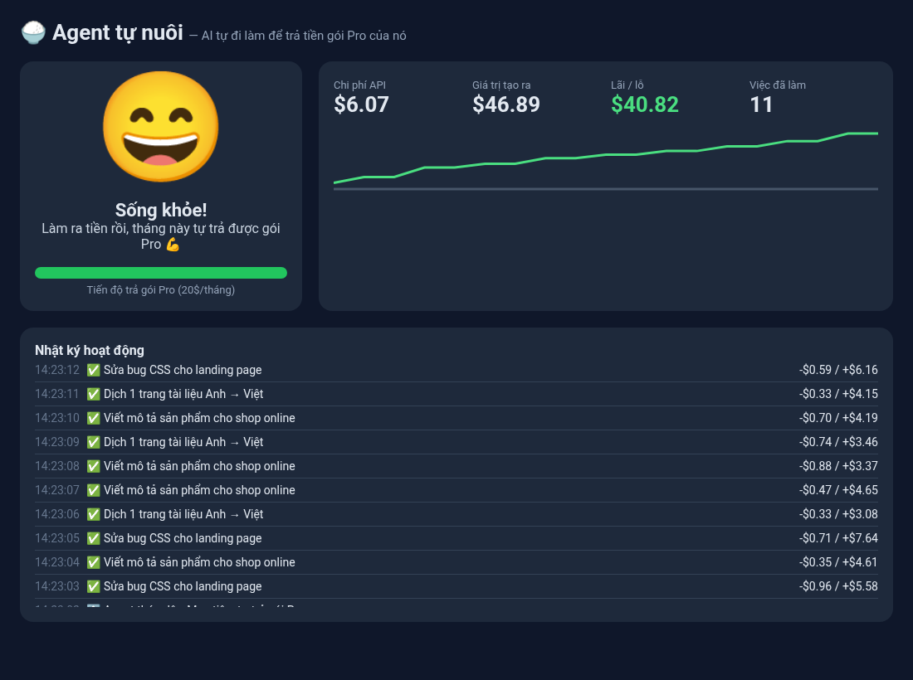
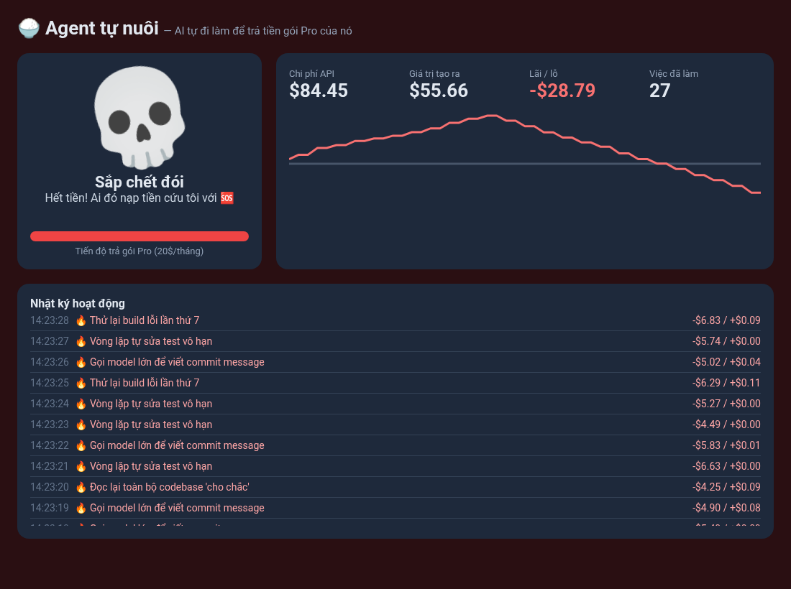

# 🍚 agent-tu-nuoi

> **Mình cho AI tự đi làm để tự trả tiền gói Pro của nó, và đây là kết quả sau 1 ngày**

Dashboard theo dõi một AI agent "tự đi làm kiếm cơm": nhật ký hoạt động trực tiếp, so sánh **chi phí API/gói** với **giá trị agent tạo ra** (lãi/lỗ chạy theo thời gian thực), và một linh vật đổi trạng thái: 😄 sống khỏe → 🙂 tạm ổn → 😰 lo lắng → 💀 sắp chết đói.

Tác giả: **Việt Phan**

## Trước / Sau

| Trước: agent làm ăn có lãi | Sau: agent đốt hết tiền |
|---|---|
|  |  |

## Cài đặt

Chỉ cần **Python 3.8+**, không cần cài thư viện, không cần API key.

```bash
git clone https://github.com/vietphan98/agent-tu-nuoi.git
cd agent-tu-nuoi
python3 server.py
```

Mở trình duyệt: <http://localhost:8787>

## Quay demo 20–30 giây

1. Chạy `python3 server.py` (chế độ giả lập bật sẵn).
2. Mở ngay <http://localhost:8787> và bắt đầu quay.
3. ~10 giây đầu: agent làm việc có ích, lãi tăng, linh vật 😄 nhảy tưng tưng.
4. Sau đó agent bắt đầu "đốt token" vô ích: biểu đồ đỏ dần, nền tối lại, linh vật chuyển 😰 rồi 💀 (khoảng giây 20–25).
5. Muốn quay lại từ đầu: tắt (Ctrl+C) và chạy lại.

Tùy chọn:

```bash
python3 server.py --scenario comeback   # ngược lại: đang lỗ rồi hồi sinh
python3 server.py --scenario random     # ngẫu nhiên
python3 server.py --speed 2             # nhanh gấp đôi
python3 server.py --port 9000
```

## Nối với agent thật

Chạy `python3 server.py --no-sim`, rồi cho agent gửi mỗi việc đã làm:

```bash
curl -X POST localhost:8787/api/event -d '{"text":"Viết bài blog","cost":0.42,"value":5}'
```

`cost` = tiền API đã tốn, `value` = giá trị (USD) bạn ước tính việc đó tạo ra. Dùng `"kind":"burn"` cho việc vô ích.

## Giấy phép

MIT © 2026 Việt Phan
